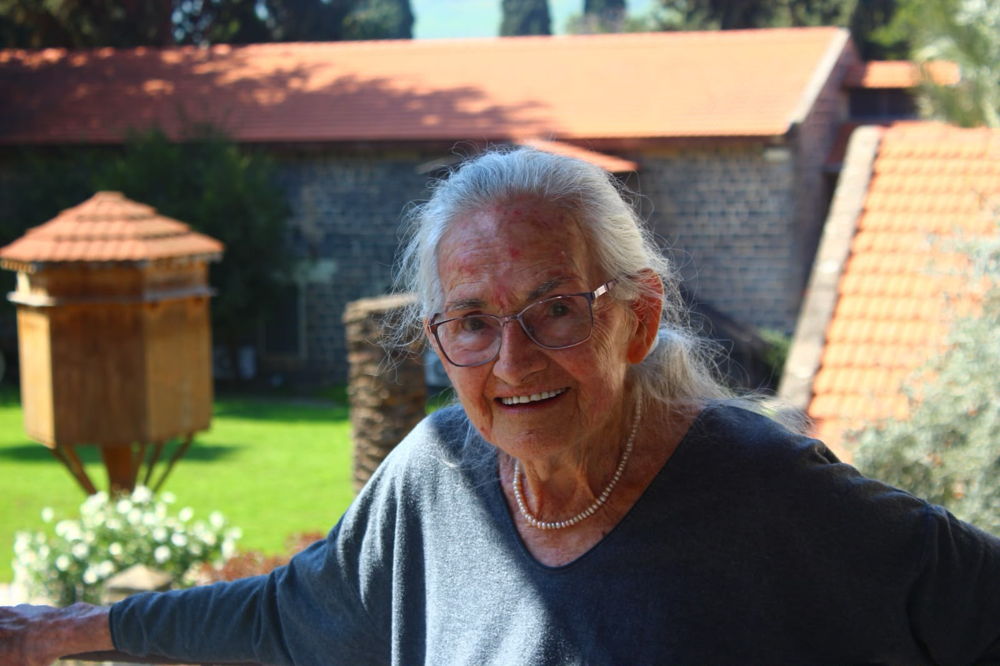

# Grandma — an Omarchy theme

A warm, quiet theme for [Omarchy](https://omarchy.org), made in loving memory of my grandma.



Every color comes from the photos of her:

| Color | Hex | From |
|-------|-----|------|
| Background | `#2a2426` | Black basalt walls, her plum sweater |
| Foreground | `#ece3d4` | Her cream linen dress and pearls |
| Accent | `#d98a62` | Terracotta roofs |
| Green | `#a8b89a` | Silvery sage bushes by the road |
| Cyan | `#9fc4c8` | The Kinneret at dusk |
| Blue | `#8fa8c8` | Evening sky over the water |
| Magenta | `#b8a0c8` | Lavender dusk, her glasses |
| Red | `#d9708a` | Her pink blouse |
| Yellow | `#e3c07a` | Golden-hour light |
| Brown | `#8a5a3e` | Her leather bag |

The wallpapers are eight photos of her: by the lake, under the roofs, at a family celebration, meeting a great-grandchild, and in her favorite armchair.

## Install

```bash
omarchy theme install https://github.com/yamz8/omarchy-grandma-theme
```
